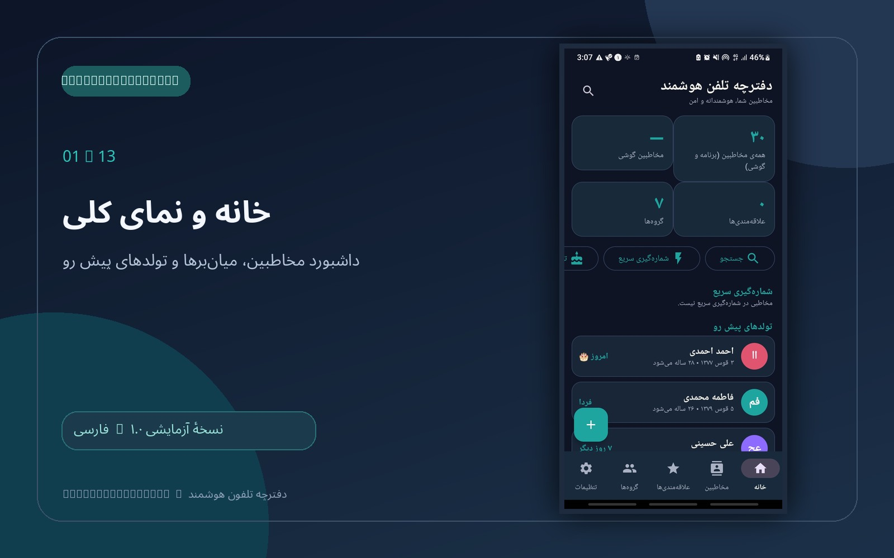
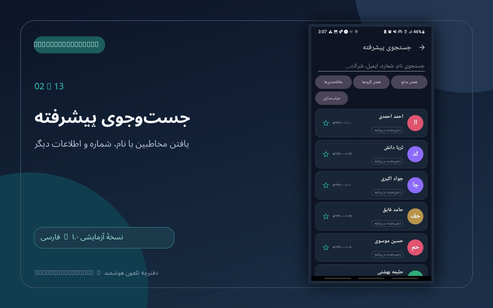
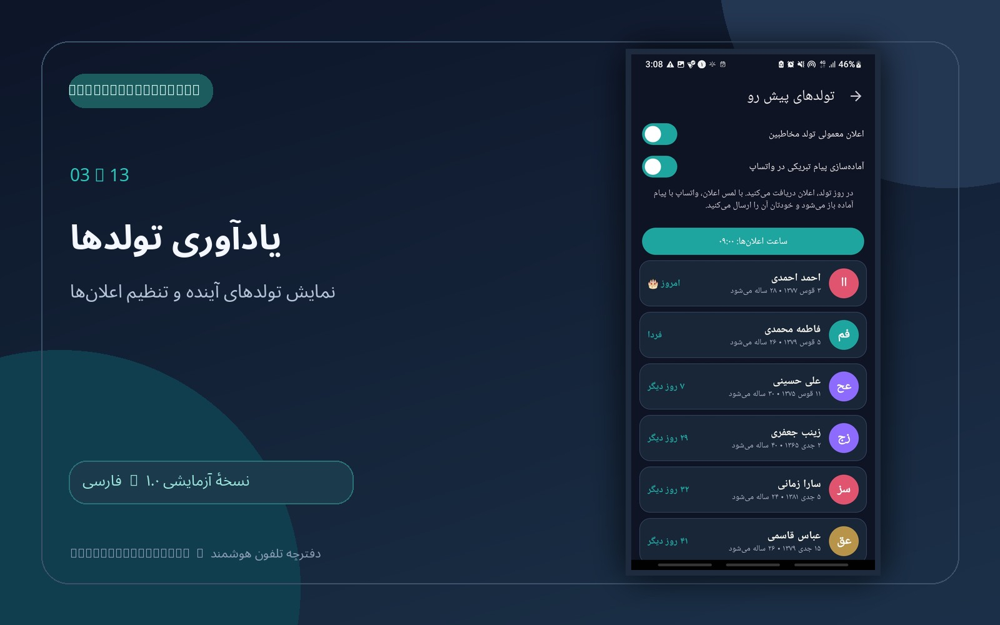
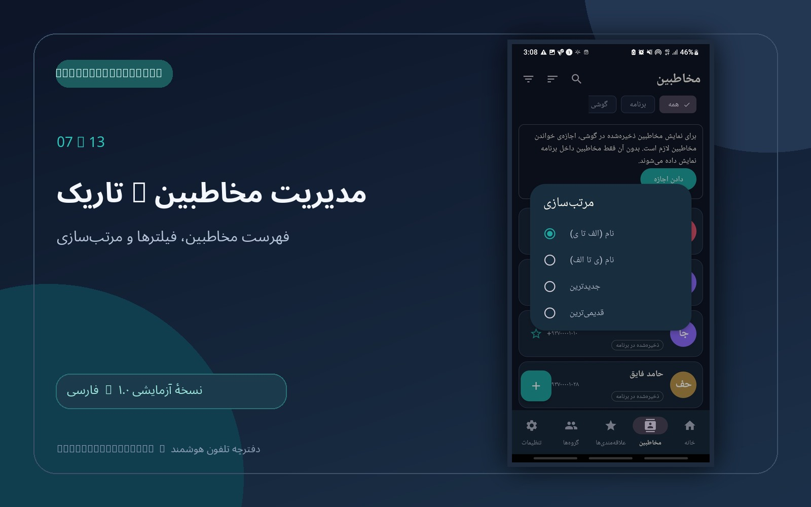
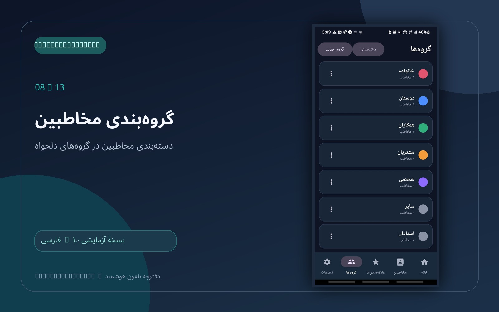
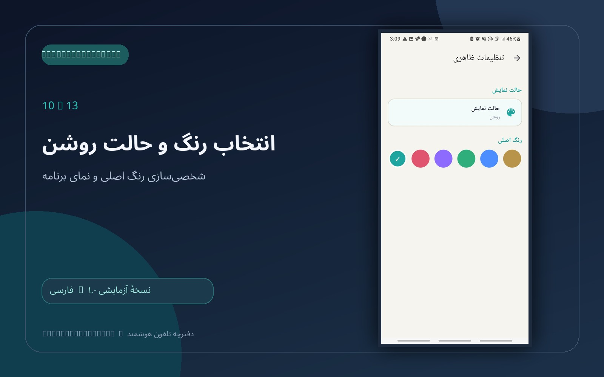
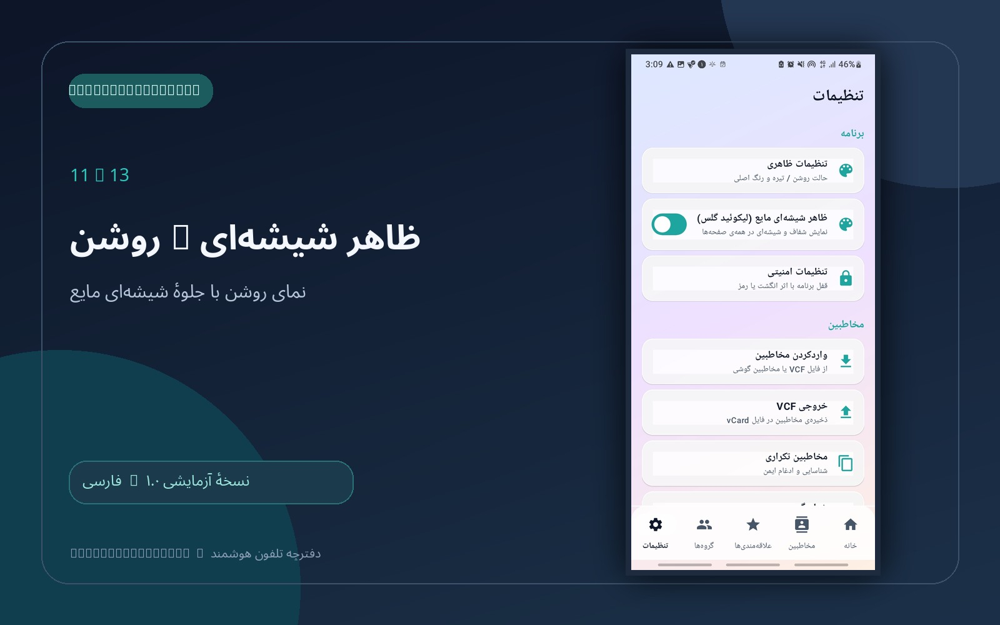

# 📱 SmartContactsPro | دفترچه تلفون هوشمند

### ✨ مخاطبین شما، هوشمندانه و امن

**یک دفترچه تلفون ساده نیست؛ راهکاری هوشمند برای مدیریت، سازمان‌دهی و محافظت از مخاطبین شماست.**

مدیریت آسان مخاطبین، یادآوری تولدها، شناسایی مخاطبین تکراری، گروه‌بندی، آمار پیشرفته و امکانات امنیتی، همه در یک برنامهٔ فارسی و زیبا!

### 📥 [دانلود آخرین نسخهٔ رسمی](https://github.com/MohaqiqCode/SmartContactsPro/releases/latest)

[📦 مشاهدهٔ همهٔ نسخه‌ها](https://github.com/MohaqiqCode/SmartContactsPro/releases) • [🐛 گزارش مشکل](https://github.com/MohaqiqCode/SmartContactsPro/issues) • [⭐ ستاره‌دادن به پروژه](https://github.com/MohaqiqCode/SmartContactsPro)

---

## 🌟 چرا SmartContactsPro؟

آیا تا به حال فراموش کرده‌اید که تولد یکی از عزیزانتان چه روزی است؟

آیا در دفترچه تلفون خود مخاطبین تکراری دارید یا پیدا کردن شمارهٔ موردنظر برایتان دشوار شده است؟

**SmartContactsPro** برای ساده‌تر کردن همین کارهای روزمره طراحی شده است.

این برنامه تلاش می‌کند مدیریت مخاطبین را از یک فهرست سادهٔ شماره‌ها به تجربه‌ای هوشمند، منظم و شخصی تبدیل کند.

### 🚀 قابلیت‌های برجسته

| قابلیت | توضیحات |
|---|---|
| 📇 مدیریت مخاطبین | افزودن، ویرایش، حذف و مشاهدهٔ اطلاعات مخاطبین |
| 🔎 جستجوی پیشرفته | جستجو بر اساس نام، شماره، ایمیل و سایر مشخصات پشتیبانی‌شده |
| 🎂 یادآوری تولد | نمایش تولدهای نزدیک و تنظیم اعلان‌های تولد |
| 💬 تبریک تولد با واتساپ | آماده‌سازی پیام تبریکی برای ارسال دستی |
| 🔁 شناسایی مخاطبین تکراری | بررسی نام‌ها، شماره‌ها و ایمیل‌های مشابه |
| 🤝 ادغام مخاطبین | مدیریت و ادغام موارد تکراری با تأیید کاربر |
| 👥 گروه‌بندی | سازمان‌دهی مخاطبین در گروه‌های دلخواه |
| ⭐ علاقه‌مندی‌ها | دسترسی سریع به مخاطبین مهم |
| ⚡ شماره‌گیری سریع | دسترسی آسان‌تر به شماره‌های پرکاربرد |
| 📊 آمار مخاطبین | نمایش نمودارها و اطلاعات آماری |
| 🔐 قفل برنامه | محافظت با رمز و روش‌های بیومتریک سازگار |
| 💾 واردکردن و خروجی VCF | انتقال و پشتیبان‌گیری از اطلاعات مخاطبین |
| 🎨 شخصی‌سازی ظاهر | حالت روشن و تاریک، رنگ‌های متنوع و ظاهر شیشه‌ای |
| 🇦🇫 رابط فارسی | محیط راست‌چین و مناسب کاربران فارسی‌زبان |

---
## 📸 نگاهی به محیط برنامه

با طراحی زیبا، رابط کاربری فارسی و امکانات هوشمند
SmartContactsPro آشنا شوید.

### 🏠 صفحهٔ اصلی

داشبوردی منظم برای مشاهدهٔ اطلاعات مهم، دسترسی سریع
به امکانات اصلی و بررسی تولدهای پیش رو.

### 🔍 جست‌وجوی پیشرفته

مخاطب موردنظر خود را سریع‌تر پیدا کنید و نتایج را
با گزینه‌های جست‌وجو و مرتب‌سازی مدیریت کنید.

### 🎂 یادآوری روزهای تولد

تاریخ تولد عزیزانتان را فراموش نکنید! تولدهای نزدیک
را مشاهده کنید و اعلان‌های یادآوری را تنظیم نمایید.

### 🔁 شناسایی مخاطبین تکراری

مخاطبین دارای نام، شماره یا ایمیل مشابه را شناسایی
کنید و پیش از ادغام، اطلاعات آن‌ها را بررسی نمایید.

### 📊 نمودارهای آماری مخاطبین

با استفاده از نمودارهای دیداری، اطلاعات مربوط به
مخاطبین و روند تغییر تعداد آن‌ها را بررسی کنید.

### 📈 آمار تفصیلی مخاطبین

اطلاعات آماری مربوط به مخاطبین، گروه‌ها،
علاقه‌مندی‌ها و سایر جزئیات را مشاهده کنید.

### 📇 مدیریت مخاطبین در حالت تاریک

فهرست مخاطبین را در محیطی مدرن و منظم مشاهده کنید
و به امکانات جست‌وجو و مدیریت آن‌ها دسترسی داشته باشید.

### 👥 گروه‌بندی مخاطبین

مخاطبین خود را در گروه‌هایی مانند خانواده،
دوستان، همکاران و استادان سازمان‌دهی کنید.

### ⚙️ تنظیمات کاربردی برنامه

تنظیمات امنیتی، شخصی‌سازی ظاهر، مدیریت مخاطبین
و امکانات واردکردن و خروجی‌گرفتن اطلاعات را
از یک بخش مدیریت کنید.

### 🎨 شخصی‌سازی رنگ‌بندی

رنگ دلخواه خود را انتخاب کنید و ظاهر برنامه
را مطابق سلیقهٔ شخصی تغییر دهید.

### 💎 طراحی شیشه‌ای (Liquid Glass)

با فعال‌سازی ظاهر شیشه‌ای، از جلوه‌های شفاف،
رنگ‌های ملایم و طراحی مدرن لذت ببرید.

### ☀️ حالت روشن برنامه

با تغییر به حالت روشن، از رابط کاربری خوانا،
هماهنگ و مناسب استفادهٔ روزمره بهره‌مند شوید.

### 🔐 امنیت و محافظت از اطلاعات

با فعال‌سازی قفل برنامه، تنظیم رمز و استفاده از
احراز هویت بیومتریک در دستگاه‌های سازگار،
دسترسی به برنامه را مدیریت کنید.

---

*

[⬇️ دانلود آخرین نسخهٔ رسمی](https://github.com/MohaqiqCode/SmartContactsPro/releases/latest)

[⭐ حمایت از پروژه در GitHub](https://github.com/MohaqiqCode/SmartContactsPro)

## 📥 دانلود و نصب

### 🎉 SmartContactsPro v1.0.0

**برنامه را دانلود کنید و مدیریت مخاطبین خود را هوشمندتر سازید.**

### [⬇️ دانلود SmartContactsPro برای اندروید](https://github.com/MohaqiqCode/SmartContactsPro/releases/latest)

### مراحل نصب

1. روی لینک دانلود بالا کلیک کنید.
2. در بخش **Assets**، فایل دارای پسوند `.apk` را دانلود کنید.
3. فایل APK را در گوشی اندرویدی خود باز کنید.
4. در صورت درخواست، اجازهٔ نصب برنامه از منبع موردنظر را در تنظیمات اندروید فعال کنید.
5. پس از نصب، برنامه را اجرا کرده و مجوزهای لازم برای قابلیت‌های موردنیاز خود را بررسی کنید.

> **نکته:** این برنامه از طریق GitHub منتشر می‌شود. برای دریافت نسخهٔ معتبر، از صفحهٔ رسمی پروژه استفاده کنید.

---

## 🔒 امنیت و حریم خصوصی

اطلاعات مخاطبین شما ارزشمند است؛ به همین دلیل، امکانات امنیتی و کنترل دسترسی بخشی مهم از طراحی SmartContactsPro هستند.

- 🔐 امکان فعال‌سازی قفل برنامه با رمز
- 👆 پشتیبانی از احراز هویت بیومتریک در دستگاه‌های سازگار
- ⏱️ تنظیم قفل خودکار برنامه
- 📱 درخواست مجوز برای دسترسی به مخاطبین گوشی
- 💬 ارسال پیام واتساپ تنها پس از اقدام و تأیید کاربر
- 💾 امکان تهیهٔ خروجی VCF از مخاطبین

**توجه:** برای اطلاع از شیوهٔ دقیق پردازش و نگهداری اطلاعات، سیاست حریم خصوصی برنامه را مطالعه کنید. قابلیت قفل برنامه جایگزین تمام سازوکارهای امنیتی سیستم‌عامل نیست.

---

## 🛠️ فناوری‌های استفاده‌شده

این پروژه برای سیستم‌عامل اندروید توسعه داده شده و از فناوری‌های زیر بهره می‌برد:

- **Java:** زبان اصلی برنامه‌نویسی
- **Android SDK:** توسعهٔ قابلیت‌های اندرویدی
- **SQLite:** مدیریت داده‌های محلی برنامه
- **XML:** طراحی رابط کاربری
- **Android Biometric APIs:** احراز هویت در دستگاه‌های سازگار
- **Android Notification APIs:** اعلان‌ها و یادآوری‌ها
- **vCard / VCF:** واردکردن و خروجی‌گرفتن اطلاعات مخاطبین

---

## 💡 برنامه‌های آینده

هدف، بهبود مستمر تجربهٔ کاربران و توسعهٔ قابلیت‌های هوشمندتر است.

برخی زمینه‌های پیشنهادی برای نسخه‌های آینده:

- 🌍 پشتیبانی از زبان‌های بیشتر
- 🔎 بهبود جستجو و فیلترگذاری
- 📊 توسعهٔ گزارش‌ها و آمار
- 🎨 بهبود طراحی و انیمیشن‌های رابط کاربری
- ⚡ بهینه‌سازی عملکرد در فهرست‌های بزرگ مخاطبین
- 🛡️ ارتقای قابلیت‌های امنیتی و پشتیبان‌گیری

این موارد برنامه‌های پیشنهادی توسعه هستند و زمان انتشار مشخصی ندارند.

---

## 🐛 گزارش مشکلات و پیشنهادها

اگر هنگام استفاده از برنامه با مشکلی روبه‌رو شدید یا پیشنهادی برای بهترشدن آن دارید، می‌توانید از بخش Issues در GitHub استفاده کنید.

### [📝 ثبت مشکل یا پیشنهاد](https://github.com/MohaqiqCode/SmartContactsPro/issues/new)

هنگام گزارش مشکل، بهتر است مدل گوشی، نسخهٔ اندروید، نسخهٔ برنامه و مراحل ایجاد مشکل را ذکر کنید.

لطفاً شماره‌های واقعی مخاطبین، رمزها و سایر اطلاعات شخصی را در گزارش‌های عمومی منتشر نکنید.

---

## 👨‍💻 توسعه‌دهنده

### Mohammad Mohaqiq | محمد محقق

**Software Developer**

با علاقه به توسعهٔ نرم‌افزار، طراحی رابط‌های کاربری و ساخت ابزارهای کاربردی برای حل مشکلات روزمره.

[🌐 GitHub](https://github.com/MohaqiqCode) • [📢 Telegram](https://t.me/mohaqiq310)

---

## ⭐ از پروژه حمایت کنید

اگر SmartContactsPro برایتان مفید بود، با دادن یک ستاره به مخزن GitHub از توسعهٔ آن حمایت کنید.

### [⭐ ستاره‌دادن به SmartContactsPro](https://github.com/MohaqiqCode/SmartContactsPro)

همچنین می‌توانید لینک برنامه را با دوستان، همکاران و سایر علاقه‌مندان به اشتراک بگذارید.

### 📱 SmartContactsPro

**مخاطبین شما، هوشمندانه و امن**

ساخته‌شده توسط محمد محقق برای تجربه‌ای بهتر در مدیریت مخاطبین

