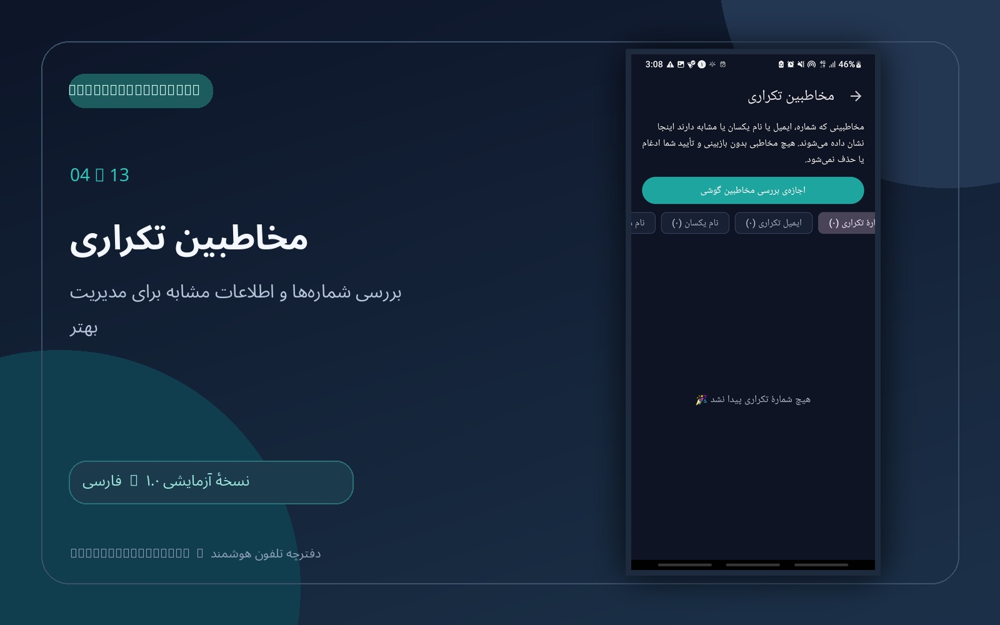
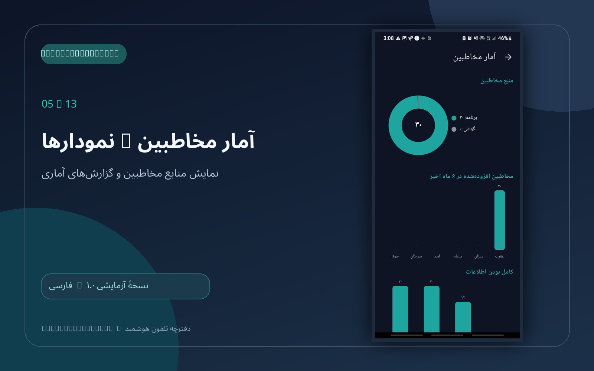
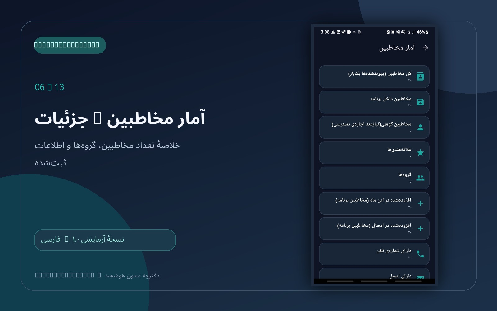
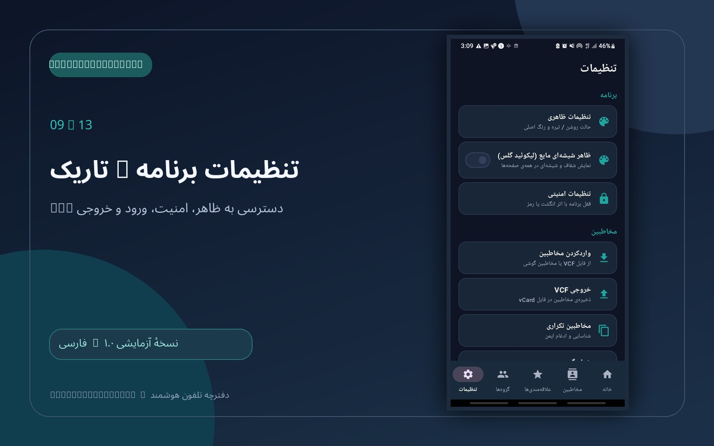
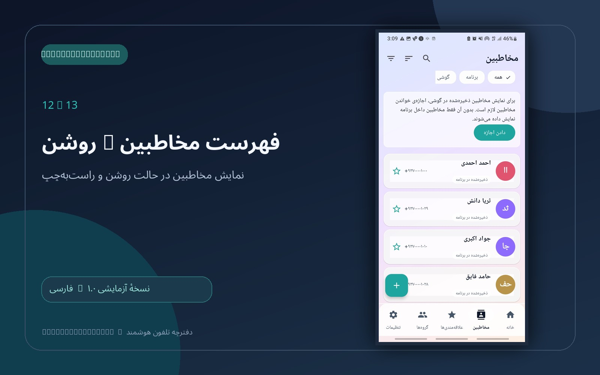
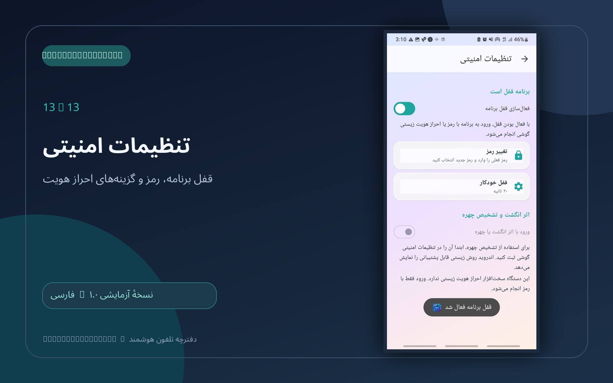

# 📱 دفترچه تلفون هوشمند | SmartContactsPro
### 🚀 انتشار نخستین نسخهٔ آزمایشی (Beta 1.0)

**مخاطبین شما، هوشمندتر، منظم‌تر و امن‌تر از همیشه!**

با افتخار، نخستین نسخهٔ آزمایشی برنامهٔ **دفترچه تلفون هوشمند** را معرفی می‌کنیم؛ یک برنامهٔ اندرویدی برای مدیریت آسان، سریع و هوشمند مخاطبین که با هدف ساده‌سازی ارتباطات روزمره و فراهم‌کردن امکانات کاربردی طراحی و توسعه یافته است.

این برنامه تلاش می‌کند مدیریت مخاطبین را از یک دفترچه تلفون ساده به تجربه‌ای هوشمند، زیبا و کارآمد تبدیل کند.

---

## ✨ امکانات برجستهٔ برنامه

### 📇 مدیریت هوشمند مخاطبین
- افزودن، ویرایش، حذف و جست‌وجوی مخاطبین
- ذخیره و مدیریت چندین شماره برای هر مخاطب
- شناسایی مخاطبین تکراری برای نظم‌دهی بهتر
- دسترسی سریع به مخاطبین پراستفاده
- نمایش اطلاعات و آمار مخاطبین

### 🎂 مدیریت روزهای تولد
- ثبت و مدیریت تاریخ تولد مخاطبین
- یادآوری روزهای تولد از طریق اعلان
- آماده‌سازی پیام تبریکی شخصی‌سازی‌شده برای واتساپ
- امکان بررسی و ارسال دستی پیام توسط کاربر

### 🔐 امنیت و حریم خصوصی
- قابلیت قفل‌گذاری برنامه با رمز PIN
- پشتیبانی از احراز هویت بیومتریک در دستگاه‌های سازگار
- امکانات امنیتی برای محافظت از دسترسی غیرمجاز به برنامه

### 💾 پشتیبان‌گیری و بازیابی
- تهیهٔ نسخهٔ پشتیبان از اطلاعات پشتیبانی‌شده
- بازیابی اطلاعات از نسخهٔ پشتیبان
- واردکردن و صادرکردن مخاطبین با فرمت VCF

### 🎨 طراحی مدرن و کاربرپسند
- رابط کاربری زیبا و شیشه‌ای
- پشتیبانی از حالت روشن و تاریک
- صفحهٔ آغازین متحرک
- طراحی مناسب برای استفادهٔ آسان و سریع

### 🇦🇫 پشتیبانی از زبان فارسی (دری)
این نسخه به زبان فارسی ارائه شده و با توجه به نیاز کاربران فارسی‌زبان، از جمله کاربران افغانستان، طراحی شده است.

پشتیبانی از زبان‌های بیشتر می‌تواند در نسخه‌های آینده اضافه شود.

---

## 📥 راهنمای دانلود و نصب

برای نصب برنامه مراحل زیر را دنبال کنید:

1. در پایین همین صفحه، بخش **Assets** را باز کنید.
2. فایل `SmartContactsPro-v1.0.0-beta.apk` را دانلود کنید.
3. فایل دانلودشده را در گوشی اندرویدی خود باز کنید.
4. در صورت درخواست سیستم، اجازهٔ نصب از منبع مورداعتماد را فعال کنید.
5. پس از پایان نصب، برنامه را باز کرده و از امکانات آن استفاده کنید.

**توجه:** برای امنیت بیشتر، فایل نصب را فقط از صفحهٔ رسمی انتشار این پروژه دریافت کنید.

---

## 🧪 دربارهٔ نسخهٔ آزمایشی

این نخستین نسخهٔ آزمایشی برنامه است و ممکن است در برخی گوشی‌ها یا شرایط خاص، مشکلاتی وجود داشته باشد.

از کاربران گرامی تقاضا داریم در صورت مشاهدهٔ خطا، مشکل در عملکرد برنامه یا داشتن پیشنهاد برای بهبود امکانات، دیدگاه‌های خود را از طریق بخش **Issues** در GitHub ثبت کنند.

بازخوردهای شما نقش مهمی در بهبود نسخه‌های آینده خواهد داشت.

---

## 🛠️ فناوری‌های استفاده‌شده

- **Java:** زبان اصلی برنامه‌نویسی
- **Android SDK:** توسعهٔ امکانات اندروید
- **SQLite:** مدیریت پایگاه دادهٔ محلی
- **XML:** طراحی رابط کاربری
- **Android Studio:** محیط توسعهٔ برنامه

---

## 🔮 برنامه‌های آینده

در نسخه‌های بعدی تلاش خواهد شد امکانات زیر توسعه و بهبود یابد:

- بهینه‌سازی سرعت و عملکرد برنامه
- بهبود طراحی و تجربهٔ کاربری
- رفع مشکلات گزارش‌شده
- افزایش امکانات مدیریت هوشمند مخاطبین
- توسعهٔ پشتیبانی از زبان‌های بیشتر

---

## ❤️ حمایت از پروژه

اگر این برنامه برایتان مفید بود، می‌توانید با ثبت یک ⭐ **Star** در GitHub از توسعهٔ آن حمایت کنید.

همچنین از پیشنهادها، انتقادهای سازنده و گزارش مشکلات استقبال می‌شود.

**👨‍💻 طراح و توسعه‌دهنده: محمد محقق**

**📱 دفترچه تلفون هوشمند — مدیریت مخاطبین، ساده‌تر و هوشمندتر!**

# 📱 گالری تصاویر دفترچه تلفون هوشمند — SmartContactsPro

### 01. خانه و نمای کلی
داشبورد مخاطبین، میان‌برها و تولدهای پیش رو

### 02. جست‌وجوی پیشرفته
یافتن مخاطبین با نام، شماره و اطلاعات دیگر

### 03. یادآوری تولدها
نمایش تولدهای آینده و تنظیم اعلان‌ها

### 04. مخاطبین تکراری
بررسی شماره‌ها و اطلاعات مشابه برای مدیریت بهتر

### 05. آمار مخاطبین — نمودارها
نمایش منابع مخاطبین و گزارش‌های آماری

### 06. آمار مخاطبین — جزئیات
خلاصهٔ تعداد مخاطبین، گروه‌ها و اطلاعات ثبت‌شده

### 07. مدیریت مخاطبین — تاریک
فهرست مخاطبین، فیلترها و مرتب‌سازی

### 08. گروه‌بندی مخاطبین
دسته‌بندی مخاطبین در گروه‌های دلخواه

### 09. تنظیمات برنامه — تاریک
دسترسی به ظاهر، امنیت، ورود و خروجی VCF

### 10. انتخاب رنگ و حالت روشن
شخصی‌سازی رنگ اصلی و نمای برنامه

### 11. ظاهر شیشه‌ای — روشن
نمای روشن با جلوهٔ شیشه‌ای مایع

### 12. فهرست مخاطبین — روشن
نمایش مخاطبین در حالت روشن و راست‌به‌چپ

### 13. تنظیمات امنیتی
قفل برنامه، رمز و گزینه‌های احراز هویت

**📥 نوت: برای نصب برنامه روی گوشی اندرویدی، فقط فایل SmartContactsPro-v1.0.0-beta.apk را دانلود کنید. دو فایل دیگر مخصوص کد منبع پروژه هستند و برای نصب برنامه نیازی به آن‌ها نیست.**
